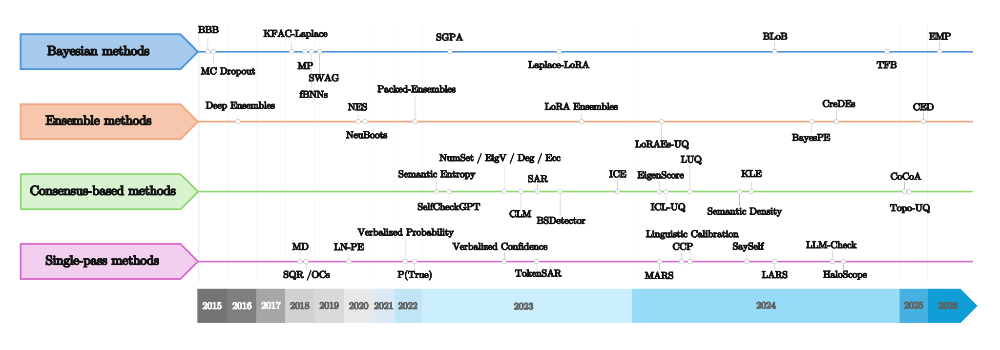
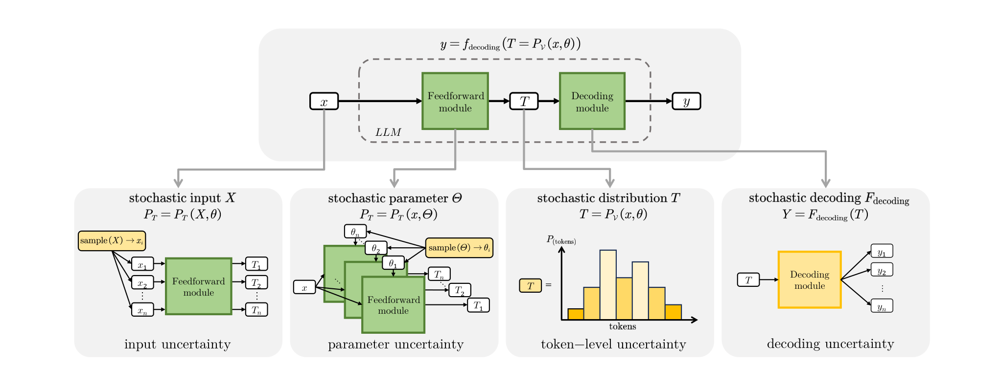
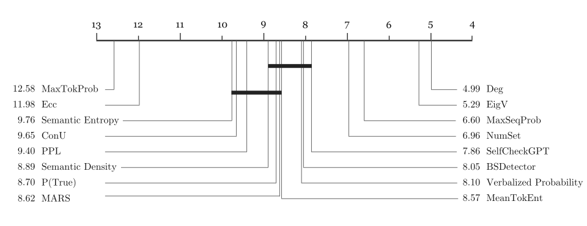
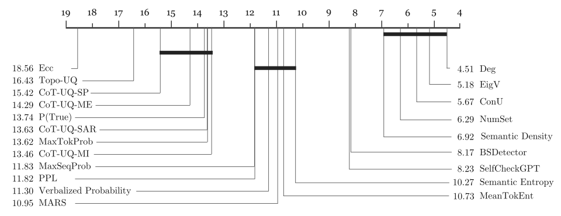
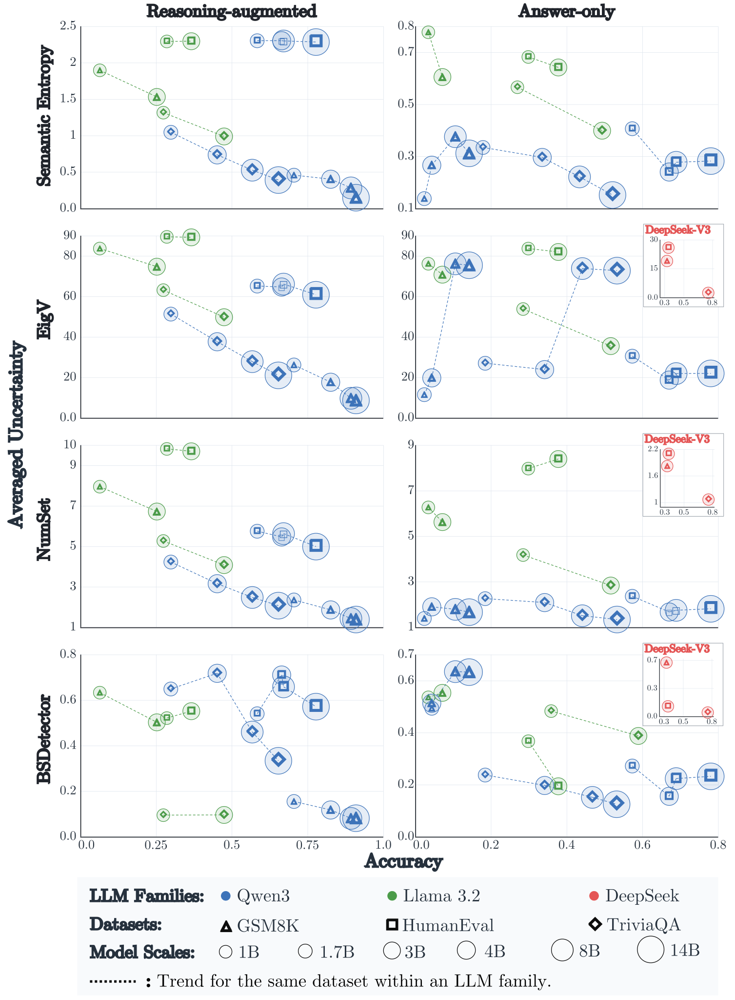

# The Origins of Stochasticity — LLM Uncertainty Quantification

**English** | [简体中文](README.zh-CN.md)

This repository contains the code accompanying **[The Origins of Stochasticity: Comprehensive Investigations on Uncertainty Quantification for Large Language Models](https://arxiv.org/abs/2606.22792)**. It provides tools for response generation, uncertainty quantification (UQ), metric evaluation, and analysis of uncertainty across model scales.

> Xiang-Jun Ou, Shuang Liang, Xin-Yu Hu, Rong-Hao Huang, Jing Wang, Shao-Qun Zhang. arXiv:2606.22792, 2026.
>
> [Abstract](https://arxiv.org/abs/2606.22792) · [Full text](https://arxiv.org/html/2606.22792v1) · [PDF](https://arxiv.org/pdf/2606.22792)

## Overview

The paper examines uncertainty arising from inputs, model parameters, token distributions, and decoding. It organizes UQ approaches into Bayesian, ensemble, consensus-based, and single-pass methods, and evaluates them from the perspectives of ranking, calibration, and coverage. Experiments cover three model families, three benchmarks, 21 UQ methods, and two generation settings, alongside an investigation of the relationship between model size and uncertainty.

The repository provides:

- **Response generation:** greedy and stochastic responses from local models or the DeepSeek API, with correctness labels, token probabilities, and reasoning information.
- **Uncertainty estimation:** a unified entry point for selecting the model family, dataset, generation setting, and UQ method.
- **Evaluation:** AUROC, AUPRC, AUARC, AURC, ECE, MCE, and Brier scores, with bootstrap statistics.
- **Scaling analysis:** grouped summaries of accuracy and average raw UQ scores from per-instance records.

## Paper and Key Findings

### Motivation and Research Questions

The same question can produce different answers, and even identical final answers can follow different reasoning paths. Assessing LLM reliability therefore requires understanding both correctness and the stochastic generation process, including whether uncertainty scores can identify errors. The paper addresses three questions: how to establish a unified UQ evaluation framework, how methods perform across tasks and generation settings, and whether output uncertainty relates to model scale.

The traditional distinction between aleatoric and epistemic uncertainty provides a conceptual foundation, but does not directly locate uncertainty within the LLM generation pipeline. The paper analyzes uncertainty along this pipeline and connects its sources to quantification methods and practical evaluation conditions.

### Development and Taxonomy of UQ Methods



*Figure 1. Representative UQ methods organized into Bayesian, ensemble, consensus-based, and single-pass approaches. The literature covered by this timeline extends beyond the 21 methods evaluated in this repository.*

| Category | Core idea | Practical considerations |
| --- | --- | --- |
| Bayesian | Characterize uncertainty through parameter distributions or posterior approximations | Parameter access, posterior approximation, and computational cost |
| Ensemble | Compare predictions from multiple models or parameter instances | Training, storage, and inference costs across models |
| Consensus-based | Estimate uncertainty from semantic agreement, clustering, or graph structure across sampled responses | Sample count, semantic comparison, and auxiliary models |
| Single-pass | Extract scores from probabilities, token statistics, or self-assessment signals associated with one generation | Available internal information and any additional scoring requirements |

The paper also compares model accessibility, training requirements, resource consumption, and evaluation objectives. Method selection should account for both estimation quality and deployment conditions.

### Four Sources of Uncertainty



*Figure 2. Inputs pass through the model to produce token distributions, which decoding converts into outputs. These stages expose distinct sources of uncertainty.*

| Source | Location | Interpretation |
| --- | --- | --- |
| Input uncertainty | Inputs and their formulation | Ambiguity, missing context, or changes in prompt wording can affect predictions |
| Parameter uncertainty | Model parameters | Different parameter instances or uncertainty in parameter estimates can produce different predictive distributions |
| Token-level uncertainty | Next-token probability distributions | Multiple candidate tokens can have similar probabilities even with fixed inputs and parameters |
| Decoding uncertainty | Conversion of distributions into output sequences | Sampling and decoding strategies can produce different complete responses from the same model |

Observed response variation can originate at different stages. Dispersed token probabilities, semantic disagreement, and parameter variation provide signals at different levels; a single score should not automatically be interpreted as a complete characterization of every source.

### Unified Evaluation Framework

The paper compares **answer-only** generation with **reasoning-augmented** generation. The former focuses on final outputs, while the latter also includes intermediate reasoning traces, extending the object of analysis to the generation process.

Evaluation covers three complementary goals: **ranking** measures whether scores distinguish correct from incorrect responses; **calibration** measures agreement between confidence estimates and empirical correctness; and **coverage** examines the risk trade-off between retaining responses and abstaining. The seven metrics and their directions are listed under “Compute Evaluation Metrics” below. Strong performance on one objective does not imply superiority on every objective or task.

The main method comparison uses Qwen3 at 1.7B and 4B, Llama 3.2 at 1B and 3B, and DeepSeek-V3 accessed through its API, covering knowledge-based question answering, mathematical reasoning, and code generation. The scaling experiments examine further parameter scales; see Figure 5 and Section 3.4 of the paper.

### Overall Ranking: Answer-Only Generation



*Figure 3. Overall evaluation ranking in the answer-only setting. Values are aggregated average ranks: lower is better. They are neither accuracy values nor raw scores for an individual metric.*

Deg and EigV rank among the strongest methods, with average ranks of **4.99** and **5.29**, respectively. MaxSeqProb and NumSet achieve **6.60** and **6.96**. These results support using consensus and structural information across responses, while also showing the value of simple probability baselines.

Overall ranks summarize performance across experimental conditions. For a specific application, consult the per-model and per-dataset results in the paper rather than treating average ranks as a fixed ordering on every task.

### Overall Ranking: Reasoning-Augmented Generation



*Figure 4. Overall evaluation ranking in the reasoning-augmented setting; lower average ranks are better. This setting includes reasoning-aware methods such as CoT-UQ and Topo-UQ.*

Deg and EigV remain among the strongest methods, with average ranks of **4.51** and **5.18**. ConU, NumSet, and Semantic Density achieve **5.67**, **6.29**, and **6.92**, respectively. Together with Figure 3, these results show that relative performance changes with the generation setting.

Reasoning traces offer additional information, but do not guarantee a stronger overall ranking for a reasoning-specific method. UQ methods should be validated on the target model, task, and generation setting. The two figures include different numbers of methods, so average ranks should be interpreted within each setting.

### Model Scale and Output Uncertainty



*Figure 5. Accuracy and average output uncertainty across parameter scales. The left column shows reasoning-augmented generation and the right column shows answer-only generation. Rows correspond to Semantic Entropy, EigV, NumSet, and BSDetector.*

The horizontal axis represents accuracy and the vertical axis represents average uncertainty. Colors identify model families, marker shapes identify datasets, circle sizes indicate parameter scales, and dotted lines connect scales within the same model family and dataset.

The paper observes a general tendency for larger models to achieve higher accuracy and lower uncertainty estimates, moving toward the bottom-right of the plots. It describes this as an empirical scaling relationship for LLM uncertainty. Local differences remain across tasks, settings, and methods, so this is an experimental trend rather than a strict law for every model and UQ method. Raw score scales should also not be compared directly across different methods.

The `scaling_law/` directory contains corresponding per-instance records and grouped summary tools for examining accuracy alongside average raw UQ scores.

Figures 1–5 come from the [arXiv v1 paper](https://arxiv.org/html/2606.22792v1). Original SVG/PNG assets are stored locally for display. See [docs/figures/README.md](docs/figures/README.md) for the asset-to-source mapping.

## Experimental Scope

| Dimension | Coverage |
| --- | --- |
| Model families | Qwen3, Llama 3.2, DeepSeek-V3; CLI identifiers: `qwen`, `llama`, `deepseek` |
| Datasets | TriviaQA (knowledge QA), GSM8K (mathematical reasoning), HumanEval (code generation) |
| Answer-only | `answer_only`: final answer only |
| Reasoning-augmented | `reasoning_augmented`: step-by-step reasoning followed by a final answer |

The generation entry point currently supports DeepSeek only in the paper's `answer_only` configuration. Availability varies by combination; consult `registry.json` and `python run_uq.py --list`.

Unified identifiers for the 21 methods:

| Group | Identifiers |
| --- | --- |
| Probability and entropy | `max_seq_prob`, `max_tok_prob`, `mean_tok_ent`, `ppl` |
| Semantic and graph-based | `num_set`, `eigv`, `deg`, `ecc`, `semantic_entropy`, `semantic_density` |
| Checking, consensus, and self-assessment | `bsdetector`, `selfcheckgpt`, `conu`, `mars`, `p_true`, `verbalized_probability` |
| Reasoning-related | `cot_uq_me`, `cot_uq_mi`, `cot_uq_sar`, `cot_uq_sp`, `topo_uq` |

This table indexes the code. Refer to the paper for theoretical definitions and its method taxonomy.

## Repository Structure

```text
.
├── run_uq.py                  # Unified UQ entry point
├── registry.json              # Method/model/task/setting-to-implementation mapping
├── requirements.txt           # Main runtime dependencies
├── docs/figures/               # Paper Figures 1–5 and source attribution
├── data/                      # Data directory; prepare original benchmarks separately
├── data_generation/           # Response generation, input schema, correctness evaluation
├── UQ-methods/                # Method scripts and historical approximations
│   └── lm_polygraph_backend/  # LM-Polygraph adapter and separate dependencies
├── uq_runtime/                # Routing, backend execution, output normalization
├── metric_evaluation/         # Seven evaluation metrics and score-field mappings
└── scaling_law/
    ├── detail/                # Included per-instance CSV records
    ├── summary/               # Included summary CSV files
    └── summarize_scaling_law.py
```

## Installation

Python 3.11 in a dedicated virtual environment is recommended. Run from the project root:

```bash
python3 -m venv .venv
source .venv/bin/activate
python -m pip install --upgrade pip
python -m pip install -r requirements.txt
```

Prepare model weights separately for local inference and select a PyTorch build matching your CUDA environment. Some methods also require NLI, sentence embedding, or other auxiliary models; see the corresponding scripts for options. For metric evaluation alone, install:

```bash
python -m pip install -r metric_evaluation/requirements.txt
```

Use a separate environment for the LM-Polygraph backend and install its pinned dependencies:

```bash
python3 -m venv .venv-polygraph
source .venv-polygraph/bin/activate
python -m pip install --upgrade pip
python -m pip install -r UQ-methods/lm_polygraph_backend/requirements.txt
```

## Workflow

### 1. Prepare Data

The generator reads local JSON arrays or JSONL files, including gzip-compressed inputs. Each record must contain a question and reference answer; a unique `id` is recommended. Example GSM8K JSONL record:

```json
{"id":"example-1","question":"What is 2 + 3?","answer":"5"}
```

Common input fields:

- Question: `question`, `prompt`, `problem`, `input`, or `query`.
- Reference answer: `answer`, `answers`, `gt`, `ground_truth`, etc. Answer lists and objects containing `value` and `aliases` are supported.
- HumanEval: provide the task through `prompt`, include `test` and `entry_point`, and optionally include `canonical_solution`.

Replace dataset and model paths with actual locations. Original benchmarks are not downloaded automatically.

### 2. Generate Model Responses

Generate GSM8K responses using a local Qwen3 model:

```bash
python -m data_generation.generate \
  --family qwen \
  --model-path /path/to/Qwen3-model \
  --dataset gsm8k \
  --setting answer_only \
  --input-file data/gsm8k.jsonl \
  --output-file outputs/qwen_gsm8k_stage1.jsonl \
  --num-samples 10 \
  --device cuda
```

Each question receives one greedy response plus `--num-samples` additional stochastic responses. Alongside the stage1 JSONL file, the generator writes `.meta.json`, `.summary.json`, and `.correct.jsonl` sidecars containing configuration, summary statistics, and correctness labels.

Set `--setting reasoning_augmented` to generate reasoning traces. Increase `--max-new-tokens` for reasoning or coding tasks as needed. Use `--limit` for a small trial, `--dry-run` to check inputs and configuration, and `--resume` to continue with the original configuration.

For DeepSeek, use `--family deepseek`, supply the actual API model ID via `--model-path`, and set the `DEEPSEEK_API_KEY` environment variable. Use `--base-url` to specify the endpoint. Probability availability depends on the API response.

HumanEval runs tests through Docker by default, requiring Docker to be installed and running. `--human-eval skip` skips execution and does not produce the test labels needed for complete correctness evaluation.

### 3. Run UQ Methods

Inspect supported combinations and options:

```bash
python run_uq.py --list
python run_uq.py --help
```

The unified entry point supports these `--implementation` options:

| Option | Behavior |
| --- | --- |
| `auto` (default) | Select a backend from method registration; some methods route to LM-Polygraph |
| `local` | Use the local runner; the registry and output records identify the actual script and version |
| `lm-polygraph` | Explicitly select the LM-Polygraph backend |
| `approx` | Explicitly select a retained historical approximation |

For example, run the local Semantic Entropy route on existing stage1 responses:

```bash
python run_uq.py \
  --implementation local \
  --method semantic_entropy \
  --family qwen \
  --model-path /path/to/Qwen3-model \
  --dataset gsm8k \
  --setting answer_only \
  --input-file outputs/qwen_gsm8k_stage1.jsonl \
  --output-file outputs/semantic_entropy__qwen__gsm8k__answer_only.jsonl
```

Add `--dry-run` to inspect the actual route first. Specify auxiliary models through options such as `--nli-model`; pass additional backend arguments after `--`. For HumanEval methods requiring external correctness labels, point `--correct-file` to the generation-stage `.correct.jsonl` file.

The local runner reads existing model responses. The LM-Polygraph backend defaults to `--mode generate`, reading original tasks and generating new responses; its inputs and execution flow differ from the local stage1 workflow. In the appropriate environment, inspect:

```bash
python run_uq.py --implementation lm-polygraph --help
```

Historical approximation scripts generally end in `_approx.py`. Some local routes also select approximation scripts according to the registry, so `local` does not guarantee a non-approximate implementation. Record the actual script, implementation type, model version, and sampling configuration when comparing experiments. Local outputs include `uq_run` metadata identifying the method, score source, and implementation.

### 4. Compute Evaluation Metrics

```bash
python -m metric_evaluation.evaluate \
  --input-file outputs/semantic_entropy__qwen__gsm8k__answer_only.jsonl \
  --method semantic_entropy \
  --output-file outputs/semantic_entropy_metrics.csv \
  --bootstrap-runs 200
```

| Perspective | Metrics | Direction |
| --- | --- | --- |
| Ranking | AUROC, AUPRC | Higher is better |
| Coverage | AUARC / AURC | Higher AUARC and lower AURC are better |
| Calibration | ECE, MCE, Brier | Lower is better |

The evaluator uses method mappings to distinguish confidence from uncertainty scores. For custom fields, specify `--score-key` together with `--score-type confidence` or `uncertainty`. Supply external correctness labels using `--correct-file`.

Defaults are `minmax` calibration, 10 uniform bins, and `legacy_trapezoid` coverage computation. Calibration transformations and coverage integration choices affect results; keep them consistent when reproducing experiments. See `--help` for options. Invalid samples are skipped by default; use `--invalid-policy error` to fail instead.

### 5. Summarize Scaling Data

Create a new summary directory from the included per-instance records:

```bash
python -m scaling_law.summarize_scaling_law \
  --split all \
  --output-dir outputs/scaling_law
```

By default, the script summarizes `semantic_entropy`, `eigv`, `num_set`, and `bsdetector`, reporting sample counts, accuracy, and average raw scores by dataset, generation setting, model, and method. Select methods with `--methods`; use `--validate-sources` to check whether source files referenced by the records exist.

The script computes grouped statistics. Interpret scaling trends using each method's score direction and consistent experimental configurations.

## Reproducibility Notes

- Prepare model weights, original benchmarks, and complete generated outputs separately. Scaling-analysis detail and summary CSV files are included.
- Keep model versions, prompts, sample counts, temperature, generation length, auxiliary models, and evaluation settings consistent across comparisons.
- Methods differ in their requirements for token probabilities, full distributions, reasoning traces, or multiple responses. API outputs may not satisfy white-box method requirements.
- Multiple implementations and historical approximations are retained. Check `registry.json`, the actual route, and method scripts for supported combinations and implementation provenance.

## Method Introduction PDFs

Survey materials are stored in [`UQ-methods-Introduction/`](UQ-methods-Introduction/):

- **Complete version:** [LLM-UQ-Survey.pdf](UQ-methods-Introduction/LLM-UQ-Survey.pdf), containing all 109 slides.
- **Individual methods:** [`methods/`](UQ-methods-Introduction/methods/) contains 33 PDFs, one per method and three pages each, preserving the original figures, formulas, and references.

The tables below cover all 33 methods, with a short description, local introduction PDF, and original paper. Categories follow the presentation's organization; some methods span categories, and multiple measures may originate from the same paper. The survey covers more methods than the codebase implements.

### Bayesian Methods

| Method | Core idea | Introduction | Original paper |
| --- | --- | --- | --- |
| Laplace-LoRA | Applies a Laplace posterior approximation to LoRA parameters to estimate parameter uncertainty and improve calibration. | [PDF](UQ-methods-Introduction/methods/Laplace-LoRA.pdf) | [Bayesian Low-rank Adaptation for Large Language Models](https://arxiv.org/abs/2308.13111) |

### Ensemble Methods

| Method | Core idea | Introduction | Original paper |
| --- | --- | --- | --- |
| BayesPE | Learns weights over semantically equivalent prompts and combines their predictions. | [PDF](UQ-methods-Introduction/methods/BayesPE.pdf) | [Bayesian Prompt Ensembles: Model Uncertainty Estimation for Black-Box Large Language Models](https://aclanthology.org/2024.findings-acl.728/) |
| Deep Ensembles | Combines predictions from independently trained models to estimate uncertainty. | [PDF](UQ-methods-Introduction/methods/Deep-Ensembles.pdf) | [Simple and Scalable Predictive Uncertainty Estimation using Deep Ensembles](https://arxiv.org/abs/1612.01474) |
| LoRA Ensembles | Shares a backbone across independently trained LoRA adapters for efficient ensembling. | [PDF](UQ-methods-Introduction/methods/LoRA-Ensembles.pdf) | [LoRA ensembles for large language model fine-tuning](https://arxiv.org/abs/2310.00035) |

### Consensus-Based Methods

| Method | Core idea | Introduction | Original paper |
| --- | --- | --- | --- |
| SPUQ | Aggregates responses sampled under input perturbations to estimate uncertainty. | [PDF](UQ-methods-Introduction/methods/SPUQ.pdf) | [SPUQ: Perturbation-Based Uncertainty Quantification for Large Language Models](https://arxiv.org/abs/2403.02509) |
| ConU | Combines semantic frequency and consistency with conformal prediction. | [PDF](UQ-methods-Introduction/methods/ConU.pdf) | [ConU: Conformal Uncertainty in Large Language Models with Correctness Coverage Guarantees](https://aclanthology.org/2024.findings-emnlp.404/) |
| SelfCheckGPT | Checks consistency between a target response and sampled responses to detect potential hallucinations. | [PDF](UQ-methods-Introduction/methods/SelfCheckGPT.pdf) | [SelfCheckGPT: Zero-Resource Black-Box Hallucination Detection for Generative Large Language Models](https://aclanthology.org/2023.emnlp-main.557/) |
| NumSet | Counts semantic equivalence classes among sampled responses. | [PDF](UQ-methods-Introduction/methods/NumSet.pdf) | [Generating with Confidence: Uncertainty Quantification for Black-box Large Language Models](https://arxiv.org/abs/2305.19187) |
| EigV | Uses graph Laplacian eigenvalues from a response similarity graph. | [PDF](UQ-methods-Introduction/methods/EigV.pdf) | [Generating with Confidence: Uncertainty Quantification for Black-box Large Language Models](https://arxiv.org/abs/2305.19187) |
| Deg | Measures agreement through node degrees in a response similarity graph. | [PDF](UQ-methods-Introduction/methods/Deg.pdf) | [Generating with Confidence: Uncertainty Quantification for Black-box Large Language Models](https://arxiv.org/abs/2305.19187) |
| Ecc | Measures distances from a centroid in a spectral embedding of the similarity graph. | [PDF](UQ-methods-Introduction/methods/Ecc.pdf) | [Generating with Confidence: Uncertainty Quantification for Black-box Large Language Models](https://arxiv.org/abs/2305.19187) |
| BSDetector | Combines sampled-response consistency with model self-reflection to estimate confidence. | [PDF](UQ-methods-Introduction/methods/BSDetector.pdf) | [Quantifying Uncertainty in Answers from any Language Model and Enhancing their Trustworthiness](https://aclanthology.org/2024.acl-long.283/) |
| D-UE | Uses claim-level response augmentation and directed entailment graphs. | [PDF](UQ-methods-Introduction/methods/D-UE.pdf) | [LLM Uncertainty Quantification through Directional Entailment Graph and Claim Level Response Augmentation](https://arxiv.org/abs/2407.00994) |
| CSS | Uses contrastive semantic similarity features to measure response dispersion. | [PDF](UQ-methods-Introduction/methods/CSS.pdf) | [CSS: Contrastive Semantic Similarity for Uncertainty Quantification of LLMs](https://arxiv.org/abs/2406.03158) |
| LofreeCP | Constructs conformal prediction sets without logits using frequency, semantic entropy, and similarity. | [PDF](UQ-methods-Introduction/methods/LofreeCP.pdf) | [API Is Enough: Conformal Prediction for Large Language Models Without Logit-Access](https://aclanthology.org/2024.findings-emnlp.54/) |
| EigenScore | Measures semantic dispersion using hidden-state covariance across sampled generations. | [PDF](UQ-methods-Introduction/methods/EigenScore.pdf) | [INSIDE: LLMs’ Internal States Retain the Power of Hallucination Detection](https://arxiv.org/abs/2402.03744) |
| Semantic Entropy | Clusters sampled responses by meaning and computes entropy over semantic clusters. | [PDF](UQ-methods-Introduction/methods/Semantic-Entropy.pdf) | [Detecting hallucinations in large language models using semantic entropy](https://www.nature.com/articles/s41586-024-07421-0) |
| Semantic Density | Estimates response confidence through probability density in semantic space. | [PDF](UQ-methods-Introduction/methods/Semantic-Density.pdf) | [Semantic Density: Uncertainty Quantification for Large Language Models through Confidence Measurement in Semantic Space](https://arxiv.org/abs/2405.13845) |
| SAR | Reweights token- and sentence-level uncertainty according to semantic relevance. | [PDF](UQ-methods-Introduction/methods/SAR.pdf) | [Shifting Attention to Relevance: Towards the Predictive Uncertainty Quantification of Free-Form Large Language Models](https://aclanthology.org/2024.acl-long.276/) |
| Topo-UQ | Compares graph-structured explanations through semantic and topological differences. | [PDF](UQ-methods-Introduction/methods/Topo-UQ.pdf) | [Understanding the Uncertainty of LLM Explanations: A Perspective Based on Reasoning Topology](https://arxiv.org/abs/2502.17026) |
| CoT Entropy | Marginalizes sampled reasoning traces to estimate entropy over step-wise verification decisions. | [PDF](UQ-methods-Introduction/methods/CoT-Entropy.pdf) | [Uncertainty-Aware Step-wise Verification with Generative Reward Models](https://arxiv.org/abs/2502.11250) |

### Single-Pass Methods

| Method | Core idea | Introduction | Original paper |
| --- | --- | --- | --- |
| CP-MCQA | Builds calibrated prediction sets for multiple-choice QA and uses set size as an uncertainty signal. | [PDF](UQ-methods-Introduction/methods/CP-MCQA.pdf) | [Conformal Prediction with Large Language Models for Multi-Choice Question Answering](https://arxiv.org/abs/2305.18404) |
| MARS | Weights token probabilities by semantic contribution instead of simple length normalization. | [PDF](UQ-methods-Introduction/methods/MARS.pdf) | [MARS: Meaning-Aware Response Scoring for Uncertainty Estimation in Generative LLMs](https://arxiv.org/abs/2402.11756) |
| CCP | Uses claim-conditioned probabilities to isolate uncertainty about claim values from wording and claim selection. | [PDF](UQ-methods-Introduction/methods/CCP.pdf) | [Fact-Checking the Output of Large Language Models via Token-Level Uncertainty Quantification](https://aclanthology.org/2024.findings-acl.558/) |
| SEPs | Trains lightweight hidden-state probes to approximate semantic entropy from one generation. | [PDF](UQ-methods-Introduction/methods/SEPs.pdf) | [Semantic Entropy Probes: Robust and Cheap Hallucination Detection in LLMs](https://arxiv.org/abs/2406.15927) |
| BLL | Fits Bayesian linear models to activation changes and aggregates posterior features to estimate reliability. | [PDF](UQ-methods-Introduction/methods/BLL.pdf) | [Can Linear Probes Measure LLM Uncertainty?](https://arxiv.org/abs/2510.04108) |
| LACIE | Uses speaker–listener preference data to finetune confidence expression. | [PDF](UQ-methods-Introduction/methods/LACIE.pdf) | [LACIE: Listener-Aware Finetuning for Confidence Calibration in Large Language Models](https://arxiv.org/abs/2405.21028) |
| SaySelf | Uses supervised finetuning and reinforcement learning to produce answers, self-reflective rationales, and confidence. | [PDF](UQ-methods-Introduction/methods/SaySelf.pdf) | [SaySelf: Teaching LLMs to Express Confidence with Self-Reflective Rationales](https://arxiv.org/abs/2405.20974) |
| Linguistic Calibration | Trains confidence statements in long-form text to support calibrated downstream user predictions. | [PDF](UQ-methods-Introduction/methods/Linguistic-Calibration.pdf) | [Linguistic Calibration of Long-Form Generations](https://arxiv.org/abs/2404.00474) |
| CoT-UQ | Extracts important reasoning keywords and incorporates them into response-level UQ. | [PDF](UQ-methods-Introduction/methods/CoT-UQ.pdf) | [CoT-UQ: Improving Response-wise Uncertainty Quantification in LLMs with Chain-of-Thought](https://arxiv.org/abs/2502.17214) |
| Verbalized Probability | Trains models to express answer confidence directly in words or numbers. | [PDF](UQ-methods-Introduction/methods/Verbalized-Probability.pdf) | [Teaching Models to Express Their Uncertainty in Words](https://arxiv.org/abs/2205.14334) |
| P(IK) | Predicts whether the model knows the correct answer before generating it. | [PDF](UQ-methods-Introduction/methods/P-IK.pdf) | [Language Models (Mostly) Know What They Know](https://arxiv.org/abs/2207.05221) |
| P(True) | Estimates whether a given response is correct through true/false self-evaluation. | [PDF](UQ-methods-Introduction/methods/P-True.pdf) | [Language Models (Mostly) Know What They Know](https://arxiv.org/abs/2207.05221) |

## Citation

If this repository is useful for your research, please cite the accompanying paper:

```bibtex
@misc{ou2026originsstochasticity,
  title         = {The Origins of Stochasticity: Comprehensive Investigations on Uncertainty Quantification for Large Language Models},
  author        = {Xiang-Jun Ou and Shuang Liang and Xin-Yu Hu and Rong-Hao Huang and Jing Wang and Shao-Qun Zhang},
  year          = {2026},
  eprint        = {2606.22792},
  archivePrefix = {arXiv},
  primaryClass  = {cs.AI},
  doi           = {10.48550/arXiv.2606.22792},
  url           = {https://arxiv.org/abs/2606.22792}
}
```

## Acknowledgments

This project uses or adapts open-source tools including LM-Polygraph, SelfCheckGPT, and Hugging Face Transformers. Refer to the paper's references and the corresponding implementations for method definitions and original work.
